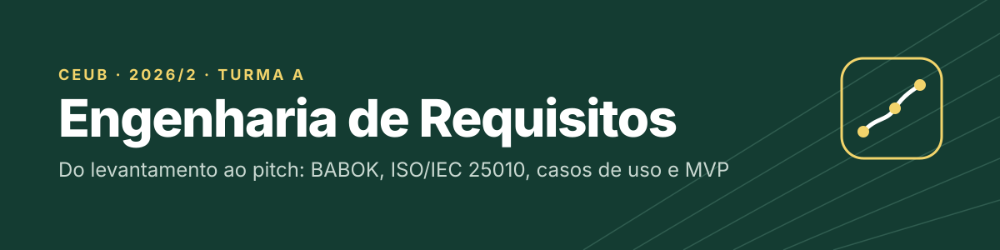
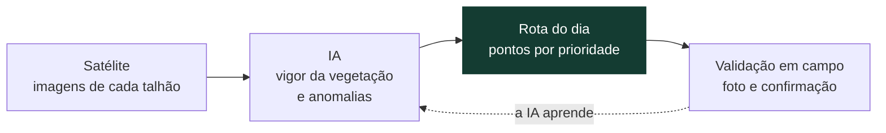

<p align="center">
  
</p>

<p align="center">
  
  
  
  
  
  
  
</p>

<p align="center">
  <a href="#-sobre">Sobre</a> ·
  <a href="#-atividades">Atividades</a> ·
  <a href="#-projeto-final-agroai">Projeto final</a> ·
  <a href="#️-estrutura">Estrutura</a> ·
  <a href="#-técnicas-e-normas">Técnicas e normas</a> ·
  <a href="#-equipe">Equipe</a>
</p>

---

## 📌 Sobre

Repositório das atividades em grupo da disciplina de **Engenharia de Requisitos** do Centro Universitário de Brasília (CEUB), turma A, 2º semestre de 2026.

As pastas seguem os temas do [repositório da disciplina](https://github.com/kadidjaoliveira-tech/Engenharia_de_Requisitos_TurmaA): a professora publica o enunciado e o grupo entrega a resolução no mesmo caminho. Ao longo do semestre o grupo passou por todas as etapas do processo: quem usa o sistema, quais são os requisitos de negócio, como medir qualidade, como modelar com casos de uso e, no fim, como apresentar um produto em formato de pitch.

## 📚 Atividades

| # | Data | Atividade | Tema | Entrega |
|:-:|:-:|---|---|:-:|
| 1 | 04/08 | [Visão geral: sistema escolar](VisaoGeral/Atividade.md) | Usuários, requisitos funcionais e não funcionais | ✅ |
| 2 | 11/08 | [Análise de negócio com BABOK](Analise_Negocio/Atividade_BABOK.md) | Problema, requisitos de negócio, arquitetura e stakeholders | ✅ |
| 3 | 18/08 | [Clínica médica: MVP](VisaoGeral/ClinicaMedica_MVP.md) e [especificação](VisaoGeral/ClinicaMedica_Formulario.md) | Regras de negócio, RFs, RNFs, MoSCoW, rastreabilidade e LGPD | ✅ |
| 4 | 08/09 | [Qualidade com a ISO/IEC 25010](ISO_IEC_25010/Atividade.md) | Avaliação de um sistema acadêmico, conflitos de qualidade e exercícios | ✅ |
| 5 | 22/09 | [Do requisito ao diagrama de casos de uso](Unidade5/Modelagem_de_Sistemas/DorequisitoaoDiagramadeCasosdeUso.md) | Atores, casos de uso, include/extend e rastreabilidade | ✅ |
| 6 | 29/09 | [Elicitação de requisitos: monitoramento agrícola](Unidade5/ElicitacaoRequisitos/Atividade.md) | Stakeholders, early adopter, canais, RNFs, trade-offs e KPIs | ✅ |
| 7 | 10/11 | [Pitch do produto: AGROAI](Unidade5/README.md) | Lean Canvas, caso de uso, diagrama de classes, equipe ágil e MVP | ✅ |

## 🌱 Projeto final: AGROAI

> **O AGROAI ajuda pequenos e médios produtores rurais a encontrar problemas na lavoura antes que virem prejuízo, por meio de imagens de satélite e IA que mostram onde ir hoje.**



| | |
|---|---|
| **Problema** | O produtor descobre pragas, falhas de plantio e falta de água tarde demais, porque não consegue olhar toda a lavoura. |
| **Para quem** | Pequenos e médios produtores, começando pelo jovem gestor que já usa o celular no campo. |
| **MVP** | Fazenda e talhões no mapa, imagens de satélite automáticas, detecção de áreas fora do padrão, rota do dia e inspeção offline. |
| **Validação** | 5 produtores usando durante 30 dias numa safra. |

O pitch completo está em [`Unidade5/README.md`](Unidade5/README.md) e a identidade visual no [Brand Book do AGROAI](Unidade5/BrandBook/BrandBook_AGROAI.pdf).

## 🗂️ Estrutura

```text
.
├── VisaoGeral/
│   ├── Atividade.md                        # 1. Sistema escolar: usuários, RFs e RNFs
│   ├── ClinicaMedica_MVP.md                # 3. Escopo do MVP da clínica médica
│   └── ClinicaMedica_Formulario.md         # 3. Especificação completa da clínica médica
├── Analise_Negocio/
│   └── Atividade_BABOK.md                  # 2. Análise de negócio com BABOK v3
├── ISO_IEC_25010/
│   └── Atividade.md                        # 4. Qualidade de software
├── Unidade5/
│   ├── README.md                           # 7. Pitch do produto AGROAI
│   ├── BrandBook/
│   │   └── BrandBook_AGROAI.pdf / .html    # Identidade visual do AGROAI
│   ├── ElicitacaoRequisitos/
│   │   └── Atividade.md                    # 6. Elicitação do sistema agrícola
│   └── Modelagem_de_Sistemas/
│       ├── DorequisitoaoDiagramadeCasosdeUso.md   # 5. Do requisito ao diagrama de casos de uso
│       └── DiagramaCasosDeUso_FazendasIA.jpeg     # Diagrama de casos de uso feito em aula
├── assets/
│   ├── banner.svg
│   └── logo/                               # Logo do AGROAI: horizontal, invertido, monocromático e ícone de app
├── LICENSE
└── README.md
```

## 🧰 Técnicas e normas

| Técnica ou norma | Onde aparece |
|---|---|
| **BABOK v3** (IIBA) | Análise de negócio, stakeholders e requisitos de negócio |
| **ISO/IEC 25010:2023** | Requisitos não funcionais mensuráveis e conflitos de qualidade |
| **MoSCoW** | Priorização dos requisitos da clínica e do AGROAI |
| **Casos de uso (UML)** | Diagramas, include/extend e especificação do UC06 |
| **Diagrama de classes (UML)** | Modelo de dados do AGROAI |
| **Lean Canvas** | Modelo de negócio do AGROAI |
| **Matriz de rastreabilidade** | Clínica médica e modelagem de casos de uso |
| **LGPD** (Lei nº 13.709/2018) | Proteção de dados na clínica e no AGROAI |

## 👥 Equipe

<table>
  <tr>
    <td align="center"><a href="https://github.com/oThiagoBraziellas"><br><b>Thiago Braziellas</b></a></td>
    <td align="center"><a href="https://github.com/arthursantos12-ceub"><br><b>Arthur Santos</b></a></td>
    <td align="center"><a href="https://github.com/lluiz22"><br><b>Luiz Claudio</b></a></td>
    <td align="center"><a href="https://github.com/PedroRLMDF"><br><b>Pedro Ryan</b></a></td>
  </tr>
</table>

Nathan Andrade participou da atividade de análise de negócio com BABOK.

## 📄 Licença

Domínio público sob [CC0 1.0](LICENSE).
