# AGROAI · MVP

<p>
  
  
  
  
  
</p>

Aplicativo web do AGROAI que roda no navegador e se adapta ao celular, ao tablet e ao computador. Ele mostra quais talhões precisam de atenção hoje, monta a rota de inspeção pelo menor caminho e registra o que o produtor encontrou no campo, mesmo sem internet.

O piloto usa uma fazenda de exemplo em **Rio Verde (GO), safra 2025/26**, com imagens reais do satélite Sentinel-2. O dia da demonstração é **sexta, 26 de dezembro de 2025**, um dia depois da última imagem analisada.

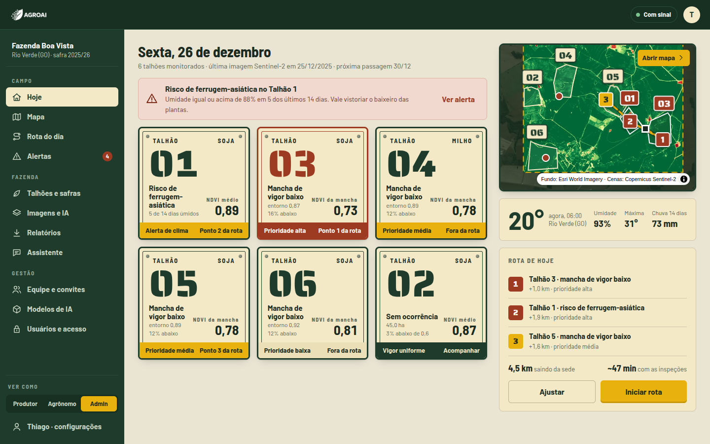

## Sumário

1. [Como rodar na sua máquina](#1-como-rodar-na-sua-máquina)
2. [Como usar em 5 minutos](#2-como-usar-em-5-minutos)
3. [Telas](#3-telas)
4. [Requisitos atendidos](#4-requisitos-atendidos)
5. [Casos de uso](#5-casos-de-uso)
6. [Perfis e acesso](#6-perfis-e-acesso)
7. [O que é real e o que é simulado](#7-o-que-é-real-e-o-que-é-simulado)
8. [Arquitetura](#8-arquitetura)
9. [Estrutura do código](#9-estrutura-do-código)
10. [Publicar na Vercel](#10-publicar-na-vercel)
11. [Limitações conhecidas](#11-limitações-conhecidas)

## 1. Como rodar na sua máquina

### Pré-requisitos

| Ferramenta | Versão | Como conferir |
|---|---|---|
| [Node.js](https://nodejs.org/) | 20 ou mais nova (testado na 24) | `node -v` |
| npm | vem com o Node | `npm -v` |
| Navegador | Chrome, Edge, Firefox ou Safari atual (precisa de WebGL) | |
| Internet | para o fundo de satélite e o relevo; o resto funciona sem rede depois de carregado | |

### Passo a passo

```bash
# 1. baixar o repositório
git clone https://github.com/oThiagoBraziellas/EngenhariaDeRequisitos.git
cd EngenhariaDeRequisitos/Unidade5/MVP

# 2. instalar as dependências (uma vez só)
npm install

# 3. abrir em modo de desenvolvimento
npm run dev
```

O terminal mostra o endereço, normalmente **http://localhost:5173**. Abra no navegador.

### Outros comandos

| Comando | O que faz |
|---|---|
| `npm run dev` | Servidor de desenvolvimento com recarga automática |
| `npm run build` | Confere os tipos (TypeScript) e gera o site estático em `dist/` |
| `npm run preview` | Serve a versão de `dist/` em http://localhost:4173, igual à de produção |
| `npm run lint` | Análise estática do código (oxlint) |

### Testar no celular

Com o computador e o celular na mesma rede Wi-Fi:

```bash
npm run dev -- --host
```

O terminal mostra um endereço `Network`, como `http://192.168.0.10:5173`. Abra esse endereço no celular.

GPS e câmera no celular só funcionam em HTTPS. Para testar esses dois recursos, use a versão publicada na Vercel (seção 10).

### Problemas comuns

| Sintoma | Causa e solução |
|---|---|
| `npm: command not found` | Node.js não está instalado. Instale a versão LTS em nodejs.org. |
| Erro de sintaxe ao rodar `npm run dev` | Node antigo. Atualize para a versão 20 ou mais nova. |
| Mapa cinza, sem fundo de satélite | Sem internet ou rede bloqueando `server.arcgisonline.com`. As cenas do Sentinel-2 continuam aparecendo. |
| Mapa todo preto | O navegador está sem WebGL. Ative a aceleração de hardware nas configurações. |
| Quer começar do zero | Perfil → "Apagar dados". Os dados ficam só no navegador. |

## 2. Como usar em 5 minutos

O app abre direto na Fazenda Boa Vista, sem login.

1. **Hoje:** veja as seis placas dos talhões. As vermelhas e amarelas têm alerta, com o NDVI da mancha contra o entorno.
2. **Mapa:** toque no ▶ da faixa "Safra 2025/26" para ver a lavoura mudar nas 6 imagens reais. Troque a camada para **Uso do solo** ou **Relevo**. Toque num talhão para abrir a placa dele.
3. **Alertas:** abra "Mancha de vigor baixo" no Talhão 3 e veja a evidência: o recorte da imagem, o NDVI da mancha e a hipótese da IA. Inclua ou tire o ponto da rota.
4. **Rota do dia:** toque em **Iniciar rota**. Fora da fazenda de exemplo o trajeto é simulado. Em **Cheguei ao ponto**, escolha "Usar foto de exemplo", marque o achado e salve.
5. **Sem sinal:** no topo, toque em **Com sinal** para simular a falta de internet. As inspeções ficam guardadas e sobem sozinhas quando o sinal volta.
6. **Imagens e IA:** processe a passagem de 20/12 (descartada por nuvem) e a de 16/01 para ver as 7 etapas do processamento.
7. **Modelos de IA** (perfil Admin): depois de registrar inspeções, recalibre o modelo e publique a versão nova.

Para trocar de perfil, use **Ver como** no fim do menu, ou abra o endereço com `?perfil=admin` ou `?perfil=agronomo`.

## 3. Telas

| Tela | O que tem |
|---|---|
| **Hoje** | Placas dos 6 talhões (número, cultura, NDVI, estado), alerta de clima, mini-mapa com a rota, clima e rota do dia |
| **Mapa** | Fundo de satélite com as cenas Sentinel-2 encaixadas por coordenada, contornos dos talhões, manchas detectadas, linha do tempo da safra com reprodução, camadas de NDVI, cor real, uso do solo e relevo |
| **Talhão** | Placa, área, perímetro, NDVI mínimo e % abaixo de 0,6, curva de vigor da safra, mapa do talhão e as 6 cenas na mesma escala |
| **Alertas** | Lista com filtro por prioridade e detalhe com evidência (NDVI, cor real e data anterior), números da mancha, hipótese da IA e ações |
| **Rota do dia** | Mapa com a rota desenhada, ordem pelo menor caminho, pontos fora da rota para incluir, distância e tempo |
| **Navegação** | Posição, rumo e distância até o ponto, com GPS real dentro da fazenda ou trajeto simulado |
| **Inspeção** | Foto pela câmera, achado, gravidade e observação; funciona sem internet |
| **Fila e resumo** | Inspeções guardadas no aparelho, envio quando o sinal volta e resumo do dia para o agrônomo |
| **Talhões e safras** | Tabela com cultura, plantio, colheita prevista e origem; edição da safra |
| **Desenhar talhão** | Clique nos cantos sobre a imagem, arraste para ajustar; área, perímetro e NDVI médio na hora; importação do CAR |
| **Imagens e IA** | Passagens do satélite e o processamento passo a passo |
| **Relatórios** | Relatório do talhão pronto para salvar em PDF |
| **Assistente** | Perguntas sobre a rota, os talhões, pragas, clima e NDVI |
| **Equipe e convites** | Quem tem acesso, convite por e-mail ou celular, quem recebe o resumo do dia |
| **Modelos de IA** | Precisão, recalibração com o retorno do campo, comparação e publicação de versões |
| **Usuários e acesso** | Contas, fazendas e histórico de acesso com as tentativas negadas |
| **Perfil** | Horário da rota, notificação no aparelho, WhatsApp, mapas sem sinal, baixar e apagar dados |

| Mapa e safra | Alerta com evidência |
|---|---|
| 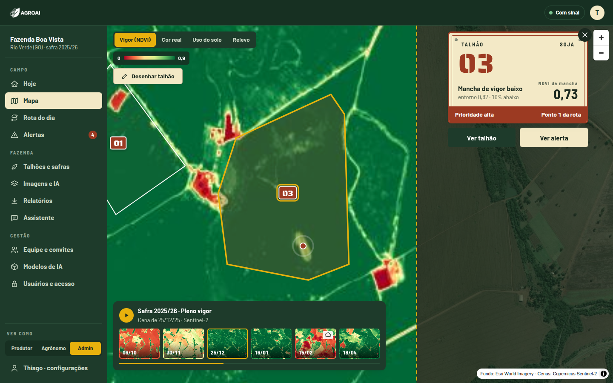 | 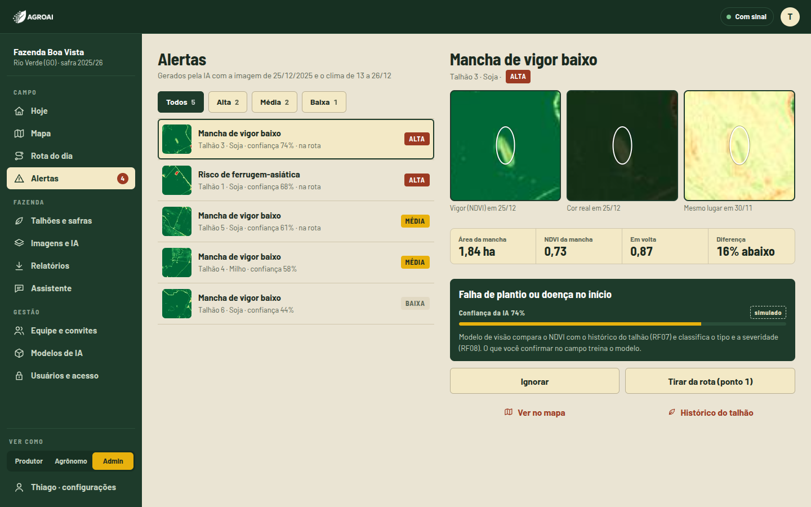 |
| **Rota do dia** | **Talhão** |
| 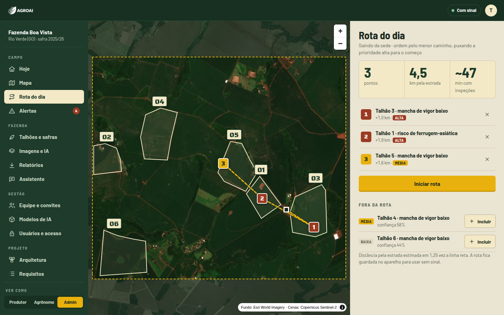 | 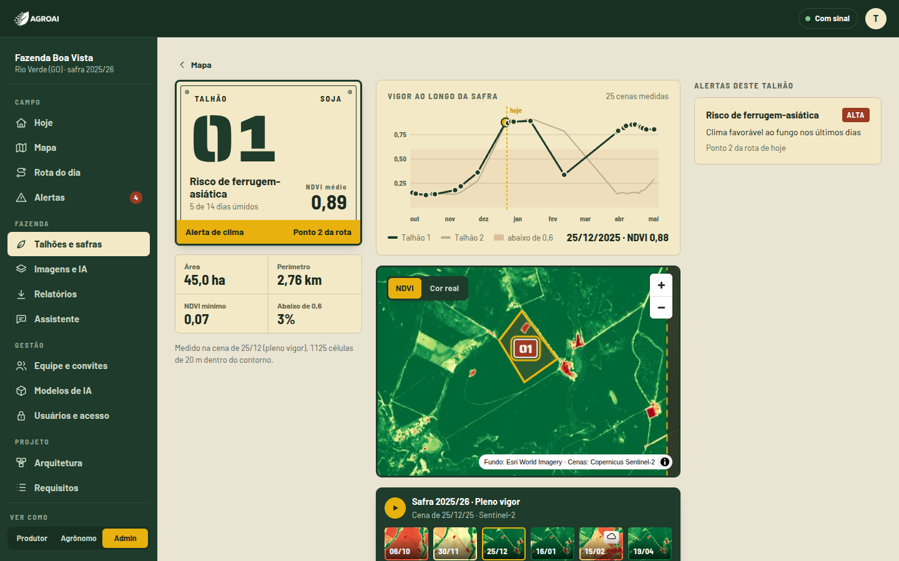 |
| **Imagens e IA** | **Modelos de IA** |
| 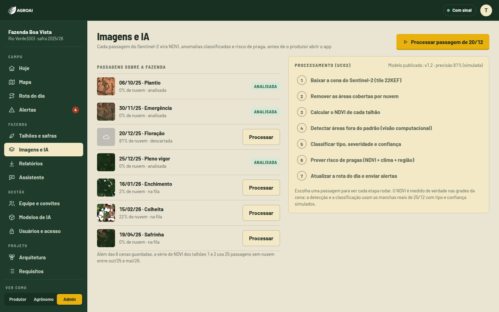 | 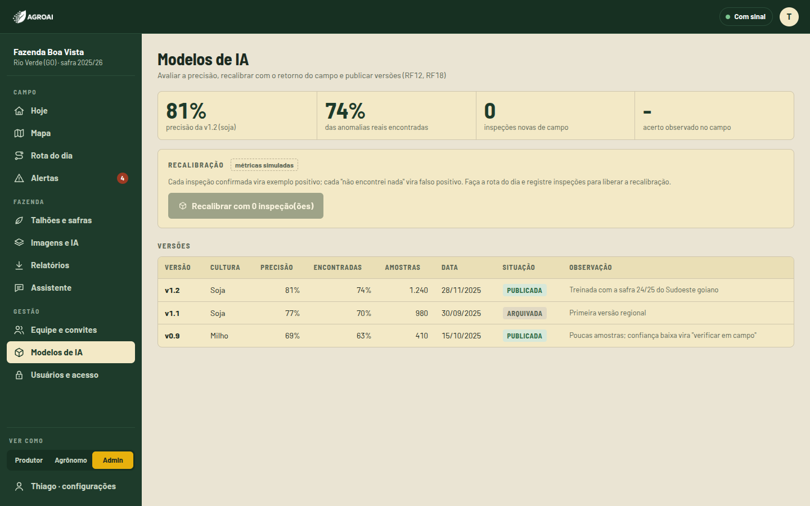 |
| **Desenhar talhão** | **Relatório em PDF** |
| 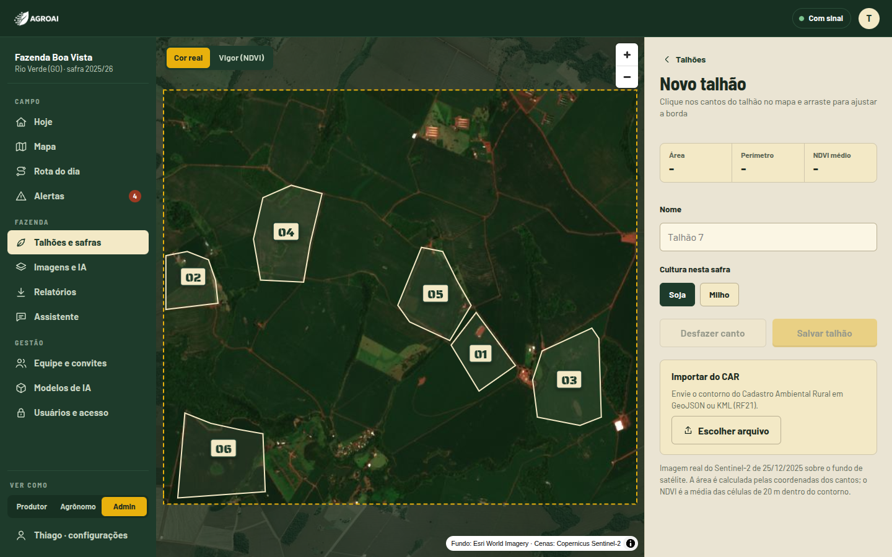 | 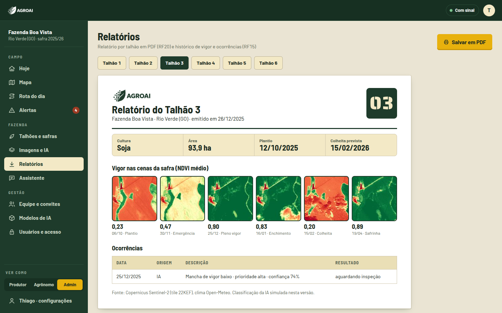 |

No celular as abas ficam embaixo e cada tela ocupa a largura toda:

| Hoje | Rota | Alerta | Navegação |
|---|---|---|---|
| 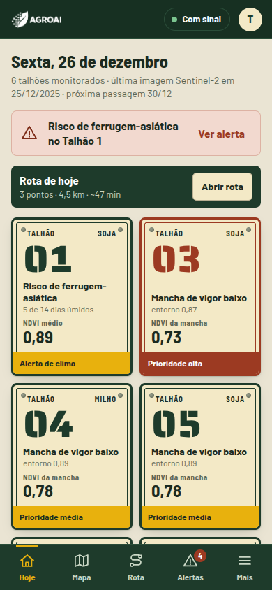 | 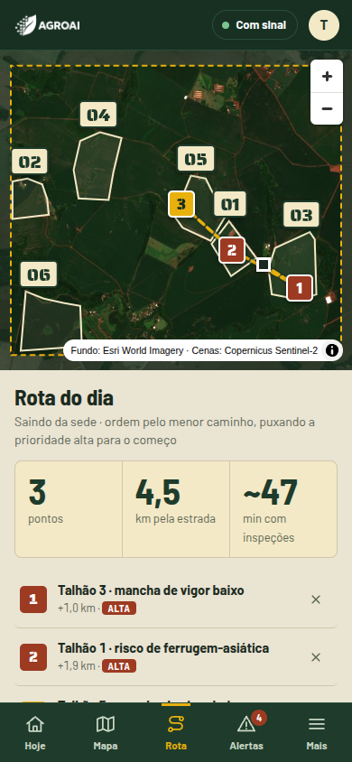 | 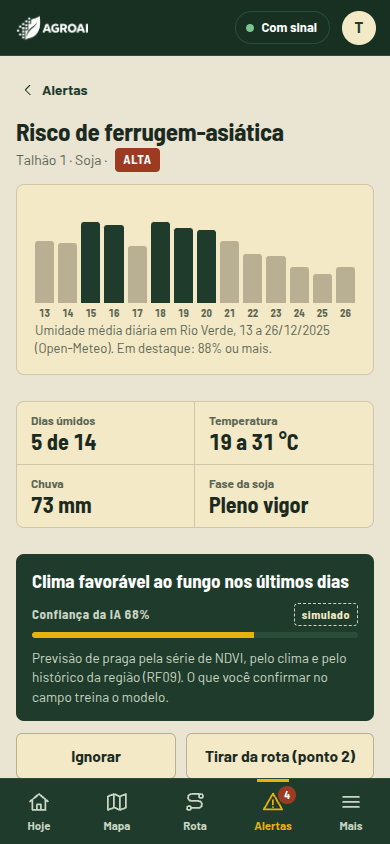 | 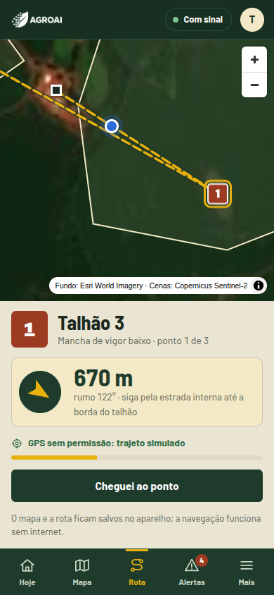 |

## 4. Requisitos atendidos

Os requisitos são os da [seção 5 do pitch](../README.md#5-requisitos-do-produto).

**Situação:** **Feito** = funciona no app; **Parcial** = funciona com uma parte simulada; **Simulado** = a tela existe, mas o resultado não vem de um modelo real.

| ID | Requisito | MoSCoW | Situação | Onde está |
|---|---|:-:|:-:|---|
| RF01 | Cadastro e login com perfil | Must | Parcial | Perfis produtor, agrônomo e administrador; sem tela de login nesta versão |
| RF02 | Cadastrar a fazenda | Must | Feito | Fazenda de exemplo; dados em Perfil e Usuários |
| RF03 | Desenhar os talhões no mapa | Must | Feito | Talhões → Desenhar |
| RF04 | Definir cultura e safra | Must | Feito | Talhões → Editar safra |
| RF05 | Imagens do Sentinel-2 sem nuvem | Must | Parcial | Imagens e IA; descarte acima de 60% de nuvem |
| RF06 | NDVI de cada talhão | Must | Feito | Placas, Talhão, Desenhar |
| RF07 | Detectar áreas fora do padrão | Must | Parcial | Alertas (manchas reais de 25/12) |
| RF08 | Classificar tipo e severidade | Must | Simulado | Alertas → hipótese da IA |
| RF09 | Prever risco de pragas | Must | Parcial | Alerta de ferrugem com o clima real |
| RF10 | Rota do dia por prioridade | Must | Feito | Rota do dia |
| RF11 | Inspeção com foto e confirmação | Must | Feito | Inspeção |
| RF12 | Recalibrar o modelo | Should | Simulado | Modelos de IA |
| RF13 | Alerta push | Should | Feito | Perfil → Notificação no aparelho |
| RF14 | GPS até o ponto | Should | Parcial | Navegação |
| RF15 | Histórico do talhão | Should | Feito | Talhão e Relatórios |
| RF16 | Convidar agrônomo | Should | Feito | Equipe e convites |
| RF17 | Resumo do dia ao agrônomo | Should | Parcial | Fila e resumo |
| RF18 | Administrador avalia e publica modelos | Should | Feito | Modelos de IA |
| RF19 | Alertas por WhatsApp | Could | Parcial | Perfil → WhatsApp (abre a mensagem pronta) |
| RF20 | Relatório em PDF | Could | Feito | Relatórios → Salvar em PDF |
| RF21 | Importar contorno do CAR | Could | Feito | Desenhar → Importar do CAR (GeoJSON ou KML) |
| RF22 | Uso do solo | Could | Feito | Mapa → Uso do solo |
| RF23 | Relevo e terreno | Could | Feito | Mapa → Relevo |
| RF24 | Chat com IA | Could | Simulado | Assistente |
| RF25 a RF27 | Drone, cooperativas, defensivo | Won't | Fora | O assistente recusa indicar defensivo |

| ID | Requisito não funcional | Como o MVP atende |
|---|---|---|
| RNF01 | Inspeção sem internet | Salva no aparelho e envia sozinha quando o sinal volta |
| RNF02 | Rota rápida no celular | A rota é calculada no próprio aparelho |
| RNF03 | Uso sem treinamento | Uma ação principal por tela, linguagem do campo, alvos grandes |
| RNF04 | Proteção dos dados (LGPD) | Perfis, convites, tentativas negadas registradas, baixar e apagar dados |
| RNF05 | Comunicação criptografada | Publicado só por HTTPS |
| RNF06 | Alerta no tempo certo | Notificação ao fim do processamento da imagem |
| RNF07 | Disponibilidade | Site estático; a meta de 99,5% depende do servidor futuro |

## 5. Casos de uso

### UC01 · Consultar a rota do dia

| Passo | Onde |
|---|---|
| 1. Ver os pontos priorizados e a data da imagem | Rota do dia |
| 2. Iniciar a rota | Rota do dia → Iniciar rota |
| 3. Seguir até o ponto | Navegação |
| 4. Tirar a foto e informar o achado | Inspeção |
| 5. Salvar e seguir para o próximo ponto | Inspeção |
| 6. Ver o resumo e enviar ao agrônomo | Fila e resumo |

**Fluxos alternativos:**
- **A1 · Nenhum ponto crítico:** tire todos os pontos da rota; o app avisa quando chega a próxima imagem.
- **A2 · Imagem com nuvem:** a passagem de 20/12 é descartada e a rota continua com a de 25/12.
- **A3 · Sem internet:** com "Sem sinal" ligado, a inspeção fica guardada no aparelho.
- **A4 · Não encontrei nada:** o ponto vira falso positivo e entra na recalibração.

### UC02 · Detectar e classificar anomalias com IA

| Passo | Onde |
|---|---|
| 1. Baixar a imagem e remover a nuvem | Imagens e IA |
| 2. Calcular o NDVI de cada talhão | Imagens e IA (medido nas grades reais) |
| 3. Marcar as áreas fora do padrão | Alertas |
| 4. Classificar tipo, severidade e confiança | Alertas → hipótese da IA |
| 5. Prever o risco de pragas | Alerta de ferrugem-asiática |
| 6. Atualizar a rota e enviar o alerta | Rota do dia e notificação |

**Fluxos alternativos:**
- **A1 · Muita nuvem:** a passagem de 20/12, com 81% de nuvem, é descartada.
- **A2 · Confiança baixa:** o alerta do Talhão 6, com 44%, aparece como "verificar em campo".
- **A3 · Cultura sem modelo:** ao mudar a cultura de um talhão para Feijão, o app avisa que a IA usa só a queda de NDVI.
- **A4 · Provedor fora do ar:** fica para a versão com servidor; esta versão mantém a última análise válida.

## 6. Perfis e acesso

| Perfil | Vê | Não vê |
|---|---|---|
| **Produtor** | Tudo da fazenda; desenha talhões, edita safras, convida a equipe | Modelos de IA e Usuários |
| **Agrônomo** | Talhões, alertas, rota, inspeções, relatórios e assistente | Equipe, Modelos de IA, Usuários; não altera talhões |
| **Administrador** | Tudo, incluindo Modelos de IA e Usuários e acesso | |

Quem abre uma tela que o perfil não permite recebe um aviso, e a tentativa fica registrada em **Usuários e acesso**.

## 7. O que é real e o que é simulado

**Real:**
- 6 cenas Copernicus Sentinel-2 (tile 22KEF, 06/10/2025 a 19/04/2026) e as grades de NDVI de cada uma, a 20 m por célula.
- Série de NDVI de 25 passagens sem nuvem para os talhões 1 e 2.
- Manchas detectadas na cena de 25/12/2025, com área e NDVI medidos.
- Clima diário de Rio Verde de 13 a 26/12/2025 (Open-Meteo).
- Contornos dos talhões traçados sobre a imagem; área, perímetro e NDVI calculados por coordenadas.
- Uso do solo calculado com as cenas de outubro (seca) e dezembro (lavoura de pé).
- Fundo Esri World Imagery e relevo dos Terrain Tiles (AWS).
- Rota, fila offline, notificação do navegador, câmera e GPS.

**Simulado (o app avisa na tela):**
- Tipo, severidade e confiança da IA; previsão de praga por regra de clima.
- Métricas de precisão e recalibração dos modelos.
- Envio ao servidor; WhatsApp abre a mensagem pronta em vez de enviar sozinho.
- Assistente: responde com os dados da fazenda, sem modelo de linguagem.

Não existe backend. Tudo o que o usuário faz fica salvo no próprio navegador (localStorage).

## 8. Arquitetura

Na versão completa, o processamento pesado roda no servidor antes de o produtor abrir o app. O celular só recebe a rota pronta. Este MVP é a camada do aplicativo, com os dados reais já processados dentro dele.

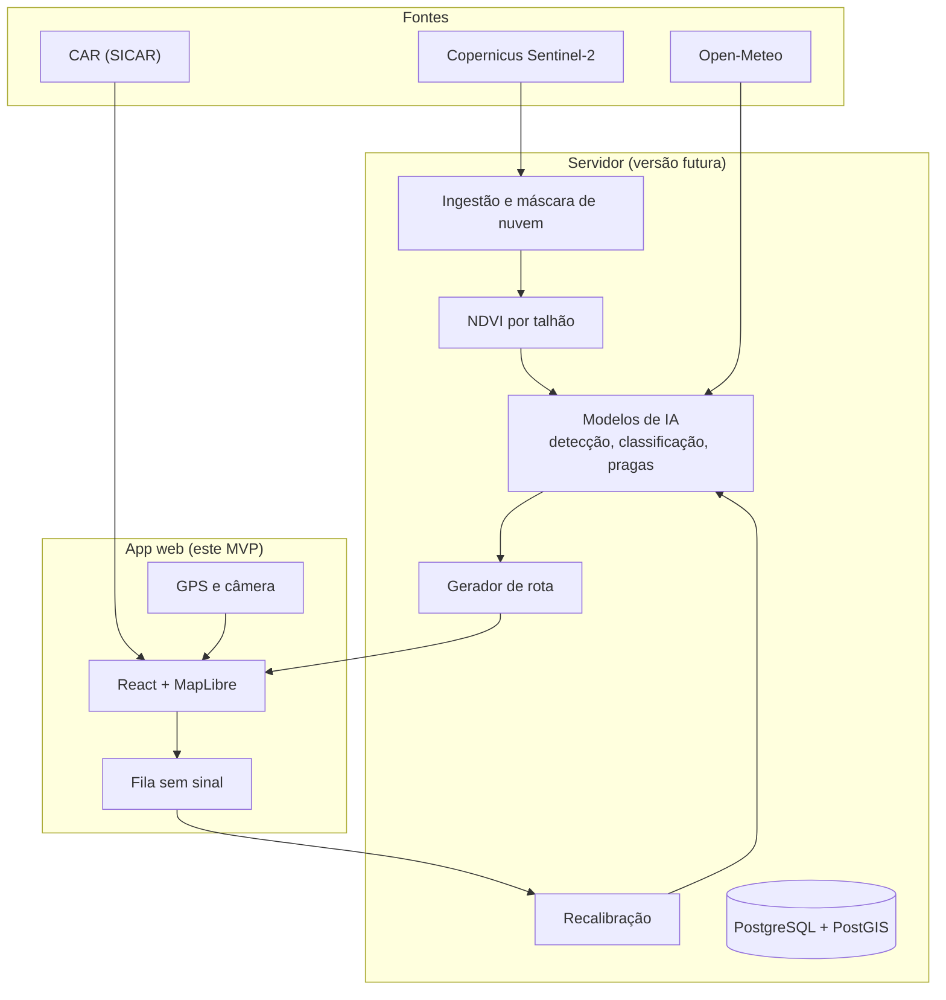

**Pilha:** Vite 8, React 19 e TypeScript; MapLibre GL 6 para o mapa; Motion para as animações (rota que se desenha, lista que se reordena, troca de telas, bússola); fontes Barlow e Saira Stencil hospedadas no próprio app.

**Modelo de dados:** as classes do [diagrama de classes](../README.md#7-diagrama-de-classes) têm correspondentes no código:

| Classe | No código |
|---|---|
| Usuario | `estado.usuario` e `estado.membros` |
| Fazenda | `estado.fazenda` |
| Talhao | `TALHOES_BASE` e `estado.proprios` (polígono em coordenadas) |
| Safra | `estado.safras` |
| ImagemSatelite | `IMAGENS` e `estado.passagens` |
| ModeloIA | `estado.modelos` |
| Anomalia | `ALERTAS` e `ZONAS` |
| Rota | `rotaOrdenada()` |
| Inspecao | `estado.insp` |
| Alerta | notificação do navegador, WhatsApp e resumo |

## 9. Estrutura do código

```text
MVP/
├── index.html
├── package.json
├── vite.config.ts
├── public/
│   ├── cenas/            # 6 cenas Sentinel-2 (cor real e NDVI) e foto de exemplo
│   ├── grades/           # grades de NDVI (valor × 250) usadas nas medições
│   └── logo_branca.png
├── src/
│   ├── main.tsx
│   ├── App.tsx           # casca: barra, menu lateral, abas do celular e rotas
│   ├── index.css         # cores, fontes e peças básicas
│   ├── telas.css         # layout de cada tela e versões de celular
│   ├── comp/
│   │   ├── Mapa.tsx      # MapLibre: cenas, talhões, manchas, rota, desenho, uso do solo, relevo
│   │   ├── Pecas.tsx     # placa do talhão, linha do tempo da safra, curva de NDVI, avisos
│   │   └── Icone.tsx     # ícones desenhados em SVG
│   ├── lib/
│   │   ├── dados.ts      # talhões, alertas, clima e formatação
│   │   ├── estado.ts     # estado salvo no navegador, perfis, rota, recalibração
│   │   ├── geo.ts        # coordenadas, área, distância e rumo
│   │   ├── ndvi.ts       # leitura das grades e NDVI dentro de um polígono
│   │   ├── solo.ts       # classificação do uso do solo
│   │   ├── menu.ts       # itens do menu por perfil
│   │   └── rotas.ts      # navegação por endereço (#/mapa, #/talhao/T1)
│   ├── data/             # dados reais extraídos das cenas (JSON)
│   └── telas/            # uma tela por arquivo
└── docs/telas/           # capturas usadas neste README
```

## 10. Publicar na Vercel

1. Em [vercel.com](https://vercel.com), escolha **Add New → Project** e importe este repositório.
2. Em **Root Directory**, informe `Unidade5/MVP`.
3. A Vercel reconhece o Vite sozinha: comando `npm run build`, pasta `dist`.
4. Clique em **Deploy**. A cada push na `main`, o site atualiza sozinho.

## 11. Limitações conhecidas

- Sem servidor: os dados ficam só no navegador de quem usa, e cada pessoa vê a própria cópia.
- Fazenda única de exemplo; os contornos dos talhões foram traçados à mão sobre a imagem.
- A previsão de praga usa uma regra de clima, não um modelo treinado.
- O fundo de satélite e o relevo precisam de internet; as cenas do Sentinel-2 vêm junto com o app.
- O pacote principal tem cerca de 1,5 MB, a maior parte do MapLibre.

---

Dados: Copernicus Sentinel-2 (ESA), Open-Meteo, Esri World Imagery, Mapzen Terrain Tiles (AWS).
