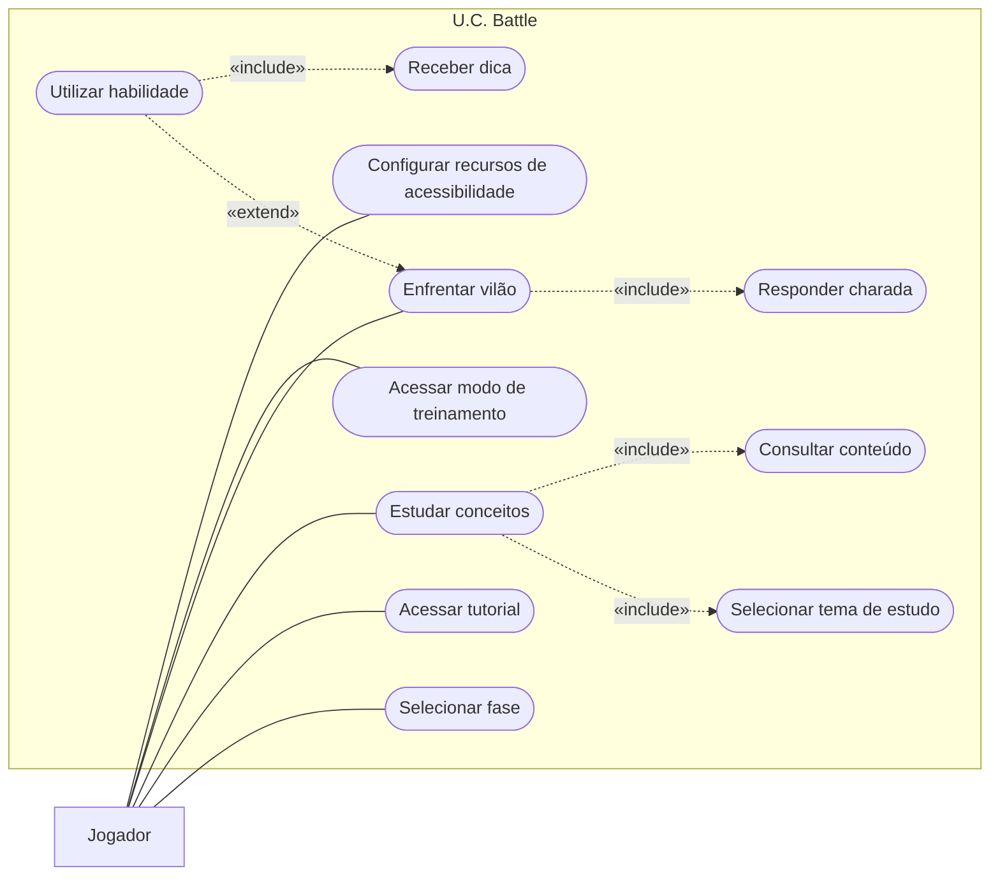

# Do requisito ao diagrama de casos de uso: U.C. Battle

**Atividade:** 22/09/2026 · Unidade 5, Modelagem de Sistemas
**Grupo:** Thiago Braziellas, Arthur Santos, Luiz Claudio e Pedro Ryan

Análise do artigo sobre o **U.C. Battle**, um jogo educativo e acessível para ensinar UML. A partir da descrição do sistema, o grupo identificou ator, requisitos e regras de negócio, transformou os requisitos em casos de uso, montou o diagrama e verificou a rastreabilidade.

---

## 1. Leitura e identificação

**Qual é o objetivo principal do U.C. Battle?**
Ensinar conceitos de UML, principalmente o diagrama de casos de uso, por meio de um jogo educativo e acessível.

**Quem interage diretamente com o sistema?**
O jogador.

**Quais funcionalidades são oferecidas ao jogador?**
Selecionar fase, acessar tutorial, estudar conceitos, selecionar tema de estudo, consultar conteúdo, enfrentar vilões, responder charadas, utilizar habilidades, receber dicas, acessar o modo de treinamento e configurar a acessibilidade.

**Quais regras condicionam o uso da habilidade de receber uma dica?**
A habilidade só pode ser usada uma vez por batalha e quando o jogador tem dois pontos de vida ou menos.

**Quais funcionalidades contribuem para a acessibilidade do jogo?**
O modo de treinamento, a configuração de recursos de acessibilidade, a narração, os sons e as músicas e a ausência de limite de tempo.

---

## 2. Ator e requisitos funcionais

**Ator:** Jogador. É o único papel externo que interage com o sistema. Heróis, vilões e NPCs são personagens dentro do jogo, controlados pelo próprio sistema, e por isso não são atores.

| ID | Requisito funcional |
|---|---|
| RF01 | O software deverá permitir ao usuário selecionar uma fase. |
| RF02 | O software deverá permitir ao usuário selecionar a opção de tutorial. |
| RF03 | O software deverá permitir ao usuário selecionar a opção de estudar conceitos. |
| RF04 | O software deverá permitir ao usuário escolher um tema para estudar. |
| RF05 | O software deverá permitir ao usuário consultar o conteúdo do tema selecionado. |
| RF06 | O software deverá permitir ao usuário enfrentar um vilão respondendo charadas. |
| RF07 | O software deverá permitir ao usuário responder as charadas apresentadas durante o combate. |
| RF08 | O software deverá permitir ao usuário utilizar uma habilidade para receber uma dica. |
| RF09 | O software deverá permitir ao usuário acessar o modo de treinamento. |
| RF10 | O software deverá permitir ao usuário configurar recursos de acessibilidade. |

---

## 3. Elementos identificados

| Elemento identificado | Evidência no artigo | Classificação |
|---|---|---|
| Jogador | O jogador interage diretamente com o sistema. | Ator |
| Selecionar uma fase | O software permite selecionar uma fase. | Requisito funcional |
| Acessar tutorial | O software permite selecionar a opção de tutorial. | Requisito funcional |
| Enfrentar vilão | O jogador enfrenta vilões respondendo perguntas. | Requisito funcional |
| Responder charada | O jogador responde às charadas durante o combate. | Requisito funcional |
| Utilizar habilidade | O jogador pode utilizar uma habilidade para receber uma dica. | Requisito funcional |
| Receber dica | A habilidade permite receber uma dica durante a batalha. | Requisito funcional |
| Acessar modo de treinamento | O jogo possui um modo de treinamento para praticar. | Requisito funcional |
| Estudar conceitos | O jogador pode estudar conceitos de UML. | Requisito funcional |
| Selecionar tema de estudo | O jogador pode selecionar um tema para estudar. | Requisito funcional |
| Consultar conteúdo | O sistema apresenta o conteúdo do tema selecionado. | Requisito funcional |
| Usar habilidade uma vez por batalha | A habilidade de receber dica só pode ser usada uma vez por batalha. | Regra de negócio |
| Usar habilidade com 2 pontos de vida ou menos | A habilidade só pode ser usada com dois pontos de vida ou menos. | Regra de negócio |
| Recursos de acessibilidade | Narração, sons, músicas e configurações de acessibilidade. | Requisito de acessibilidade |

---

## 4. Casos de uso

Cada requisito virou um caso de uso com verbo no infinitivo:

| Caso de uso | Origem |
|---|---|
| Selecionar fase | RF01 |
| Acessar tutorial | RF02 |
| Estudar conceitos | RF03 |
| Selecionar tema de estudo | RF04 |
| Consultar conteúdo | RF05 |
| Enfrentar vilão | RF06 |
| Responder charada | RF07 |
| Utilizar habilidade | RF08 |
| Receber dica | RF08 |
| Acessar modo de treinamento | RF09 |
| Configurar recursos de acessibilidade | RF10 |

---

## 5. Diagrama de casos de uso

### Relacionamentos

| Relacionamento | Tipo | Por quê |
|---|---|---|
| Jogador → Selecionar fase, Acessar tutorial, Estudar conceitos, Enfrentar vilão, Acessar modo de treinamento, Configurar recursos de acessibilidade | Associação | O jogador inicia cada uma dessas funcionalidades. |
| Estudar conceitos → Selecionar tema de estudo | «include» | Para estudar, o jogador sempre escolhe um tema. |
| Estudar conceitos → Consultar conteúdo | «include» | Estudar sempre mostra o conteúdo do tema escolhido. |
| Enfrentar vilão → Responder charada | «include» | Todo combate obriga o jogador a responder charadas. |
| Utilizar habilidade → Enfrentar vilão | «extend» | A habilidade é opcional e só acontece durante o combate, sob condição. |
| Utilizar habilidade → Receber dica | «include» | Usar a habilidade sempre entrega uma dica. |

### Regra de negócio

A habilidade de receber uma dica só pode ser usada **uma vez por batalha** e quando o jogador tem **dois pontos de vida ou menos**. Por isso a relação entre "Utilizar habilidade" e "Enfrentar vilão" é um «extend» condicionado, e a regra fica registrada aqui, fora do diagrama.

---

## 6. Acessibilidade, requisitos e modelagem

A acessibilidade aparece nos requisitos como recursos concretos: narração, sons, músicas, modo de treinamento sem limite de tempo e configuração dos recursos de acessibilidade. Na modelagem, ela entra como casos de uso próprios ("Acessar modo de treinamento" e "Configurar recursos de acessibilidade"). Assim a necessidade de acessibilidade fica visível no diagrama e rastreável até os requisitos RF09 e RF10.

---

## 7. Matriz de rastreabilidade

| ID | Requisito | Caso de uso | No diagrama? |
|---|---|---|---|
| RF01 | Selecionar uma fase | Selecionar fase | Sim |
| RF02 | Selecionar a opção de tutorial | Acessar tutorial | Sim |
| RF03 | Selecionar a opção de estudar conceitos | Estudar conceitos | Sim |
| RF04 | Escolher um tema para estudar | Selecionar tema de estudo | Sim |
| RF05 | Consultar o conteúdo do tema selecionado | Consultar conteúdo | Sim |
| RF06 | Enfrentar um vilão respondendo charadas | Enfrentar vilão | Sim |
| RF07 | Responder as charadas durante o combate | Responder charada | Sim |
| RF08 | Utilizar uma habilidade para receber uma dica | Utilizar habilidade + Receber dica | Sim |
| RF09 | Acessar o modo de treinamento | Acessar modo de treinamento | Sim |
| RF10 | Configurar recursos de acessibilidade | Configurar recursos de acessibilidade | Sim |

### Resultado da verificação

- **Requisito sem caso de uso:** nenhum. Os 10 requisitos têm caso de uso correspondente no diagrama.
- **Caso de uso sem requisito:** nenhum. Os 11 casos de uso vêm de algum requisito; o RF08 gerou dois casos ("Utilizar habilidade" e "Receber dica") porque a dica é um comportamento reutilizado pela habilidade.
- **Correção feita durante a verificação:** o tutorial (RF02) tinha sido ligado ao modo de treinamento. São funcionalidades diferentes, então "Acessar tutorial" ganhou caso de uso próprio.

---

## 8. Checklist

- [x] Os atores representam papéis externos ao sistema (só o Jogador).
- [x] Os casos de uso foram escritos com verbo no infinitivo.
- [x] A fronteira do sistema está identificada (U.C. Battle).
- [x] Cada associação representa uma interação real.
- [x] O «include» representa um comportamento obrigatório e reutilizado.
- [x] O «extend» representa um comportamento opcional ou condicionado.
- [x] As regras de negócio não foram representadas como atores.
- [x] Todos os requisitos estão rastreados no diagrama.
- [x] Pelo menos uma necessidade de acessibilidade foi considerada.
- [x] O diagrama está legível e sem elementos desconectados.

---

> **Sobre a imagem desta pasta:** o arquivo [DiagramaCasosDeUso_FazendasIA.jpeg](DiagramaCasosDeUso_FazendasIA.jpeg) não é do U.C. Battle. É o diagrama de casos de uso do projeto final do grupo, o sistema de análise de fazendas com IA, apresentado no [pitch do AGROAI](../README.md).
