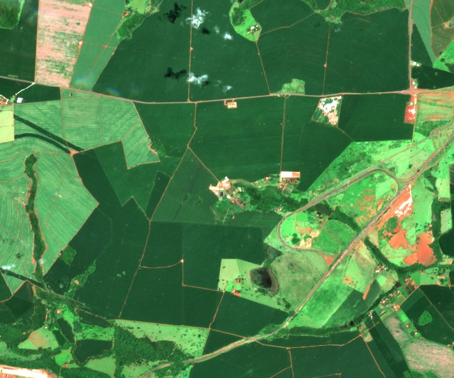
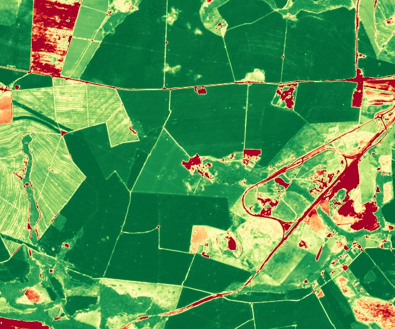
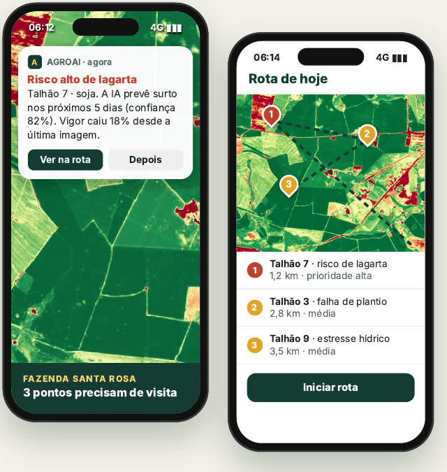
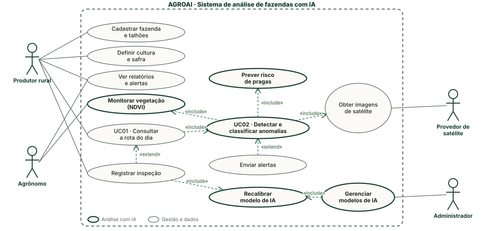
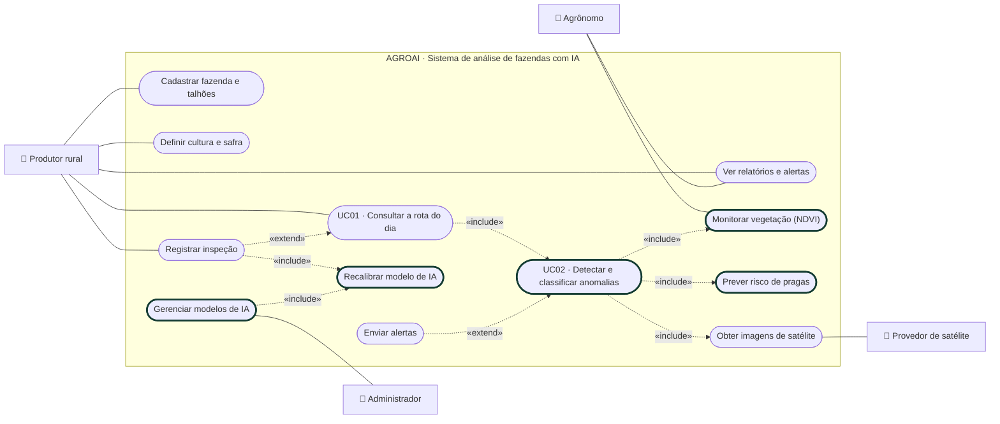
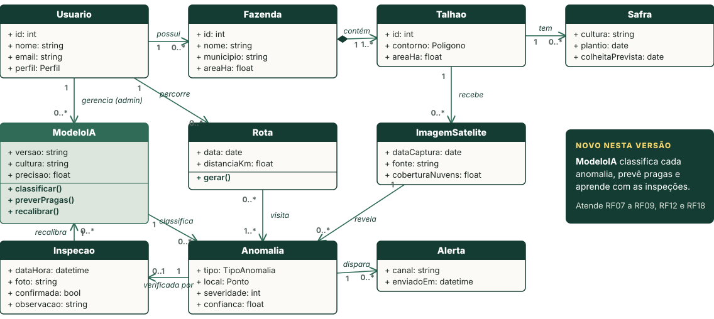
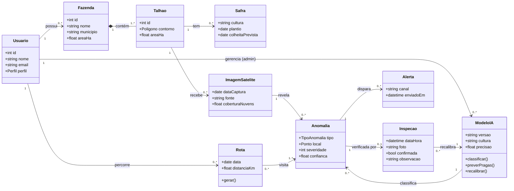

# Unidade 5 - Pitch do Produto: AGROAI

Entrega da Unidade 5 seguindo a [estrutura de pitch deck da disciplina](https://github.com/kadidjaoliveira-tech/Engenharia_de_Requisitos_TurmaA/blob/main/Unidade5/README.md). O produto é o sistema de análise de fazendas com satélite e IA levantado na [Elicitação de Requisitos](ElicitacaoRequisitos/Atividade.md).

**Apresentação:** [AGROAI_Pitch.pdf](Pitch/AGROAI_Pitch.pdf) e [AGROAI_Pitch.html](Pitch/AGROAI_Pitch.html) (no HTML, use as setas para passar os slides). São 15 slides na ordem das 11 seções do roteiro.

**Sumário:** [1. Abertura](#1-slide-de-abertura) · [2. Problema](#2-problema-e-oportunidade) · [3. Solução](#3-solução-proposta) · [4. Lean Canvas](#4-lean-canvas) · [5. Requisitos](#5-requisitos-do-produto) · [6. Casos de uso](#6-especificação-de-caso-de-uso) · [7. Classes](#7-diagrama-de-classes) · [8. Equipe](#8-estrutura-da-equipe-ágil) · [9. MVP](#9-planejamento-do-mvp) · [10. Conclusão](#10-conclusão-do-pitch) · [11. Checklist](#11-checklist-final-para-apresentação)

---

## 1. Slide de abertura

- **Nome do produto:** AGROAI
- **Frase de abertura:** *Saiba onde ir antes de sair para o campo.*
- **Proposta de valor:**
  > O AGROAI ajuda pequenos e médios produtores rurais a encontrar problemas na lavoura antes que virem prejuízo, com imagens de satélite e IA que mostram onde ir hoje.
- **Identidade visual:** logo, cores e tipografia no [Brand Book do AGROAI](BrandBook/BrandBook_AGROAI.pdf) (também em [HTML](BrandBook/BrandBook_AGROAI.html)).
- **Equipe:** Thiago Braziellas (Product Owner), Luiz Claudio (Scrum Master), Arthur Santos (Requisitos e UX) e Pedro Ryan (Desenvolvimento e testes).

## 2. Problema e oportunidade

**Problema:** o produtor não consegue olhar toda a lavoura com a frequência necessária. Quando percebe uma praga, uma falha de plantio ou a falta de água, o estrago já aconteceu.

| Número | O que significa | Fonte |
|---|---|---|
| **R$ 55 bilhões por ano** | perdidos com pragas e doenças na agricultura brasileira | Embrapa |
| **R$ 12 bilhões** | perdidos só com o percevejo-marrom na última safra de soja | Embrapa (2026) |
| **83,5 milhões de hectares** | de grãos plantados no Brasil na safra 2025/26 | Conab, 11º levantamento |

**Persona:** Seu João, 52 anos, tem 450 ha de soja e milho em Rio Verde (GO). Roda a fazenda de caminhonete e só descobre a praga quando ela já espalhou pelo talhão. *(Personagem ilustrativo, montado a partir do perfil do early adopter da elicitação.)*

**Quem é afetado:**
- Pequenos e médios produtores, que decidem e pagam a conta da perda
- Gerentes e encarregados de campo, que percorrem talhões sem problema
- Agrônomos e consultores, que perdem tempo em deslocamento sem saber onde está o foco
- Cooperativas, que sofrem com a inadimplência depois de uma safra ruim

| Dor atual | Consequência |
|---|---|
| Monitoramento por amostragem, a pé ou de caminhonete | Áreas cegas e focos descobertos tarde |
| Identificação tardia de anomalias | Perda de produtividade e remediação mais cara |
| Mão de obra, combustível e tempo gastos em áreas sem problema | Custo operacional alto e margem menor |
| Agricultura de precisão cara e complexa | O pequeno produtor fica de fora |

**Oportunidade:** o satélite Sentinel-2, do programa Copernicus, passa sobre qualquer fazenda a cada 5 dias e as imagens são gratuitas. Falta transformar essas imagens numa resposta simples para quem está no campo.

## 3. Solução proposta

### O satélite já vê o que o produtor não vê

| Cor real | NDVI, o índice de vigor da planta |
|---|---|
|  |  |
| A olho nu, a lavoura parece toda igual. | Verde-escuro é planta forte; amarelo e vermelho mostram onde vale ir. |

*Imagem real: Sentinel-2 L2A, Rio Verde (GO), 16/01/2026, 10 m por pixel (Copernicus/ESA, obtida pelo Microsoft Planetary Computer). O NDVI é calculado com as bandas do infravermelho próximo (B08) e do vermelho (B04): (B08 − B04) / (B08 + B04).*

**Fluxo dos dados:** satélite (a cada 5 dias) → modelos de IA (visão computacional e redes neurais sobre séries de NDVI) → celular (alerta e rota do dia).

### O app

*Telas ilustrativas desenhadas sobre a imagem real de Rio Verde.*

1. **Desenhe a fazenda.** Talhões, cultura e safra no mapa.
2. **A IA analisa.** A cada nova imagem, detecta as áreas fora do padrão, classifica o tipo e a severidade e prevê o risco de pragas.
3. **Vá direto ao ponto.** A rota do dia mostra os pontos em ordem de prioridade, e a inspeção é registrada com foto.

| Antes, Seu João | Depois, com o AGROAI |
|---|---|
| Sai sem saber onde ir, roda a fazenda inteira e acha a lagarta quando ela já espalhou. | Abre o app às 6h, vê 3 pontos marcados, vai direto e confirma com foto. |

**Diferenciais:** o produtor não precisa interpretar mapa de índice nem planilha. O app funciona sem sinal no campo, os dados da fazenda são protegidos (LGPD) e não é preciso treinamento técnico.

## 4. Lean Canvas

Versão visual feita pelo grupo no Figma: [imagem](LeanCanvas/LeanCanvas_AGROAI.png) e [HTML](LeanCanvas/LeanCanvas_AGROAI.html). Resumo dos 9 blocos:

| Bloco | AGROAI |
|---|---|
| **Problema** | Detecção tardia de pragas, doenças e estresse hídrico; monitoramento incompleto; inspeção presencial cara |
| **Segmentos de clientes** | Produtores de médio porte, agrônomos e consultores, cooperativas. Early adopter: jovem gestor que já usa o celular na rotina e teve perda recente |
| **Proposta de valor** | Saiba onde ir hoje no campo |
| **Solução** | Mapa de prioridade diário, validação no campo com foto, painel de evolução do talhão |
| **Canais** | Agrônomos, cooperativas, indicação entre vizinhos, dias de campo, anúncios geolocalizados e lojas de aplicativo |
| **Fontes de receita** | Assinatura SaaS por faixa de hectares; licença para cooperativas e consultorias; teste gratuito por um talhão |
| **Estrutura de custos** | Desenvolvimento, IA, imagens e infraestrutura; equipe técnica e suporte; aquisição e eventos |
| **Métricas-chave** | Tempo até o alerta, % da lavoura monitorada, precisão dos alertas validados, safras ativas (retenção) |
| **Vantagem injusta** | Dados regionais exclusivos, modelo calibrado no terreno pelas inspeções e rede técnica de agrônomos e produtores |

**Tamanho do mercado**
- **TAM:** 83,5 milhões de hectares de grãos no Brasil (Conab, safra 2025/26).
- **SAM:** a área dos pequenos e médios produtores, a medir com o Censo Agropecuário do IBGE.
- **SOM inicial:** 5 produtores parceiros no MVP.

## 5. Requisitos do produto

### Requisitos funcionais (MoSCoW)

São 27 requisitos, cada um descrevendo uma única capacidade. Para entrar como **Must**, o requisito passa por uma pergunta: *sem este item, o produtor ainda sabe onde ir hoje?* Os modelos de IA (RF07 a RF10) passam nesse filtro, porque sem eles a rota do dia vira só um mapa colorido.

| Código | O sistema deve… | Prioridade | IA |
|---|---|---|---|
| RF01 | permitir cadastro e login com perfil de produtor, agrônomo ou administrador | Must | |
| RF02 | permitir cadastrar a fazenda | Must | |
| RF03 | permitir desenhar os talhões no mapa | Must | |
| RF04 | permitir definir a cultura e a safra de cada talhão | Must | |
| RF05 | obter as imagens do Sentinel-2 a cada passagem, descartando as cobertas por nuvem | Must | |
| RF06 | calcular o NDVI (vigor da vegetação) de cada talhão | Must | |
| RF07 | detectar as áreas fora do padrão com um modelo de visão computacional | Must | ✓ |
| RF08 | classificar o tipo (praga, falta de água, erosão, falha de plantio) e a severidade de cada anomalia | Must | ✓ |
| RF09 | prever o risco de pragas com séries de NDVI, clima e histórico da região | Must | ✓ |
| RF10 | gerar a rota do dia com os pontos em ordem de prioridade | Must | ✓ |
| RF11 | permitir registrar a inspeção de um ponto com foto e confirmação | Must | |
| RF12 | recalibrar o modelo com as inspeções confirmadas em campo | Should | ✓ |
| RF13 | enviar alerta push quando surgir anomalia grave | Should | |
| RF14 | guiar o usuário até o ponto com GPS | Should | |
| RF15 | mostrar o histórico de vigor e de ocorrências do talhão | Should | |
| RF16 | permitir convidar um agrônomo para a fazenda | Should | |
| RF17 | enviar o resumo do dia ao agrônomo | Should | |
| RF18 | permitir ao administrador avaliar a precisão e publicar versões do modelo | Should | ✓ |
| RF19 | enviar alertas por WhatsApp | Could | |
| RF20 | exportar relatório do talhão em PDF | Could | |
| RF21 | importar o contorno da fazenda do CAR (Cadastro Ambiental Rural) | Could | |
| RF22 | classificar o uso do solo | Could | |
| RF23 | mapear relevo e terreno | Could | |
| RF24 | oferecer um chat com IA para o produtor perguntar sobre a lavoura | Could | ✓ |
| RF25 | usar imagens de drone | Won't (nesta versão) | |
| RF26 | integrar com cooperativas e ERPs | Won't (nesta versão) | |
| RF27 | recomendar defensivo agrícola (exige agrônomo responsável) | Won't (nesta versão) | |

**Resumo:** 11 Must, 7 Should, 6 Could e 3 Won't.

### Requisitos não funcionais (ISO/IEC 25010:2023)

| Código | Requisito | Característica | Critério de aceitação |
|---|---|---|---|
| RNF01 | Inspeção sem internet | Confiabilidade | A inspeção é salva offline e sincroniza sozinha em até 1 min depois que o sinal volta |
| RNF02 | Rota do dia rápida no celular | Eficiência de desempenho | Abre em até 3 s em 95% das vezes numa conexão 4G |
| RNF03 | Uso sem treinamento | Capacidade de interação | 4 de 5 produtores de teste chegam à primeira rota em até 10 min sem ajuda |
| RNF04 | Proteção dos dados da propriedade (LGPD) | Segurança | Só o produtor e quem ele autorizar veem a fazenda; tentativas negadas ficam registradas |
| RNF05 | Comunicação criptografada | Segurança | 100% das chamadas por HTTPS com TLS 1.2 ou superior |
| RNF06 | Alerta no tempo certo | Eficiência de desempenho | Alerta entregue em até 1 h depois que a imagem é processada |
| RNF07 | Disponibilidade | Confiabilidade | Serviço no ar em pelo menos 99,5% do mês |

O processamento pesado das imagens e dos modelos roda no servidor antes de o usuário abrir o app. O celular só recebe a rota pronta, e por isso RNF01 e RNF02 convivem com modelos de IA completos.

## 6. Especificação de caso de uso

### Diagrama de casos de uso

Os casos de uso com borda grossa são os de análise com IA. A mesma estrutura em Mermaid:

### UC01 · Consultar a rota do dia

| Campo | Descrição |
|---|---|
| **Ator principal** | Produtor rural ou encarregado de campo |
| **Atores secundários** | Provedor de satélite, agrônomo |
| **Objetivo** | Saber quais pontos da lavoura visitar hoje e registrar o que encontrou |
| **Pré-condições** | Usuário autenticado; talhões, cultura e safra cadastrados; pelo menos uma imagem já analisada pela IA |
| **Gatilho** | O usuário toca em "Rota de hoje" |
| **Requisitos** | RF10, RF11, RF14, RNF01, RNF02 |

**Fluxo principal**
1. O sistema mostra os pontos críticos, já priorizados pela IA, e a data da última imagem.
2. O usuário toca em "Iniciar rota".
3. O sistema traça o caminho até o primeiro ponto.
4. No ponto, o usuário tira uma foto e informa se o problema foi confirmado e qual é.
5. O sistema salva a inspeção e passa para o próximo ponto.
6. No fim, o sistema mostra o resumo do dia e envia o resultado ao agrônomo responsável.

**Fluxos alternativos**
- **A1 · Nenhum ponto crítico:** no passo 1, o sistema informa que não há nada para visitar hoje e mostra quando chega a próxima imagem.
- **A2 · Imagem coberta por nuvens:** no passo 1, o sistema usa a última imagem válida e mostra a data dela.
- **A3 · Sem internet no campo:** nos passos 4 e 5, a inspeção fica salva no aparelho e é enviada quando o sinal voltar (RNF01).
- **A4 · Problema não encontrado:** no passo 4, o usuário marca "Não encontrei nada"; o ponto vira falso positivo e recalibra o modelo (RF12).

**Pós-condições:** as inspeções ficam no histórico do talhão, os pontos visitados saem da rota e o modelo recebe o retorno do campo.

### UC02 · Detectar e classificar anomalias com IA

| Campo | Descrição |
|---|---|
| **Ator principal** | Provedor de satélite (dispara o caso de uso) |
| **Atores secundários** | Produtor rural e agrônomo, que recebem o resultado |
| **Objetivo** | Transformar cada nova imagem em pontos classificados e em riscos de praga |
| **Pré-condições** | Talhão com cultura e safra cadastradas; modelo de IA publicado pelo administrador |
| **Gatilho** | Nova passagem do Sentinel-2 sobre o talhão |
| **Requisitos** | RF05 a RF10, RF13 |

**Fluxo principal**
1. O sistema baixa a nova imagem e remove as áreas cobertas por nuvem.
2. O sistema calcula o NDVI de cada talhão.
3. O modelo de visão computacional compara o NDVI com o histórico do talhão e marca as áreas fora do padrão.
4. O modelo classifica cada área (praga, falta de água, erosão ou falha de plantio) com severidade e grau de confiança.
5. O sistema cruza a série de NDVI, a previsão do tempo e o histórico da região para prever o risco de pragas.
6. O sistema atualiza a rota do dia e, se o risco for alto, envia um alerta («extend» Enviar alertas).

**Fluxos alternativos**
- **A1 · Muita nuvem:** no passo 1, se a nuvem cobre a maior parte do talhão, a imagem é descartada e o sistema espera a próxima passagem.
- **A2 · Confiança baixa:** no passo 4, a área entra na rota como "verificar em campo", sem tipo definido.
- **A3 · Cultura sem modelo treinado:** nos passos 3 e 4, o sistema usa só a queda de NDVI para marcar a área.
- **A4 · Provedor fora do ar:** no passo 1, o sistema tenta de novo mais tarde e mantém a última análise válida.

**Pós-condições:** as anomalias ficam salvas com tipo, severidade e confiança, e a rota do dia é atualizada.

## 7. Diagrama de classes

**Leitura do diagrama:** o produtor possui fazendas, que contêm talhões. Cada talhão tem safras e recebe imagens de satélite. Cada imagem pode revelar anomalias, que o `ModeloIA` classifica e usa para prever pragas (RF07 a RF09). As anomalias entram na rota do dia, disparam alertas e são verificadas por uma inspeção em campo; cada inspeção recalibra o modelo (RF12). O administrador gerencia as versões do modelo (RF18).

## 8. Estrutura da equipe ágil

| Papel | Responsável | O que faz |
|---|---|---|
| Product Owner | Thiago Braziellas | Representa o produtor, mantém o backlog e decide as prioridades MoSCoW |
| Scrum Master | Luiz Claudio | Conduz as cerimônias, remove impedimentos e cuida do ritmo da sprint |
| Analista de requisitos e UX | Arthur Santos | Entrevista os produtores, escreve casos de uso e critérios de aceite e desenha as telas |
| Desenvolvimento e testes | Pedro Ryan | Implementa app, servidor e modelos de IA e testa no campo, sem internet |

**Como o time trabalha:** sprints de 2 semanas com planejamento, daily de 15 min, revisão com um produtor parceiro e retrospectiva. Uma história só está **pronta** quando passa nos critérios de aceite e funciona no celular sem internet.

## 9. Planejamento do MVP

O MVP valida uma hipótese: **a rota do dia faz o produtor achar os problemas antes e andar menos.**

| Entra no MVP (os 11 Must) | Fica para depois |
|---|---|
| Cadastro e login (RF01) | Recalibração do modelo (RF12) |
| Fazenda (RF02) e talhões no mapa (RF03) | Alerta push (RF13) e GPS até o ponto (RF14) |
| Cultura e safra (RF04) | Histórico do talhão (RF15) |
| Imagens Sentinel-2 sem nuvem (RF05) | Agrônomo convidado e resumo do dia (RF16, RF17) |
| NDVI por talhão (RF06) | Painel do modelo para o administrador (RF18) |
| IA detecta (RF07), classifica (RF08) e prevê pragas (RF09) | Os 6 Could (RF19 a RF24) |
| Rota do dia (RF10) | Fora desta versão: drones, cooperativas e recomendação de defensivo (RF25 a RF27) |
| Inspeção com foto (RF11) | |

**Como validar:** 5 produtores de diferentes culturas usando o app durante 30 dias numa safra. Vamos medir:
- a % de alertas confirmados em campo (precisão da IA);
- os dias entre o início da anomalia na imagem e a confirmação em campo;
- os hectares percorridos por semana, antes e depois;
- se o produtor continua abrindo a rota toda semana.

**Riscos**
- **Nuvens** no período de chuva atrasam a chegada de imagens novas.
- **Precisão da IA** baixa no começo, antes de haver inspeções suficientes para calibrar.
- **Adesão** do produtor que ainda não usa o celular na rotina.

## 10. Conclusão do pitch

> **Saiba onde ir. Proteja sua lavoura. Produza melhor.**

| Pergunta | Resposta |
|---|---|
| Qual é o problema? | O produtor descobre pragas, falhas e falta de água tarde demais, porque não consegue olhar toda a lavoura. |
| Para quem é a solução? | Pequenos e médios produtores, começando pelo jovem gestor que já usa o celular no campo. |
| Como ela funciona? | Satélite e modelos de IA encontram, classificam e preveem os problemas; o app transforma isso numa rota do dia. |
| Por que é importante? | Menos perda de safra, menos custo de inspeção e agricultura de precisão sem equipamento caro. |
| Como a equipe vai desenvolver e validar? | Scrum em sprints de 2 semanas e um MVP testado por 5 produtores durante 30 dias. |

## 11. Checklist final para apresentação

- [x] Problema bem definido
- [x] Público-alvo identificado
- [x] Requisitos funcionais descritos e priorizados
- [x] Requisitos não funcionais definidos
- [x] Casos de uso especificados
- [x] Diagrama de classes apresentado
- [x] Estrutura da equipe ágil explicada
- [x] Lean Canvas preenchido
- [x] MVP apresentado de forma clara
- [x] Mensagem final objetiva e convincente

---

**Fontes dos números:** [Agrolink, perdas de até R$ 55 bilhões (dados da Embrapa)](https://www.agrolink.com.br/noticias/pragas-causam-perdas-de-ate-r--55-bilhoes-a-agricultura-no-brasil_220429.html) · [Forbes Agro, perdas de R$ 12 bilhões com o percevejo-marrom (dados da Embrapa)](https://forbes.com.br/forbes-agro/2026/05/descoberta-brasileira-pode-por-em-xeque-perdas-de-r-12-bilhoes-na-soja/) · [Conab, estimativa da safra 2025/26](https://www.gov.br/conab/pt-br/estimativa-aponta-para-uma-producao-de-360-8-milhoes-de-toneladas-na-safra-2025-26-2) · Imagens: Copernicus Sentinel-2 (ESA), via [Microsoft Planetary Computer](https://planetarycomputer.microsoft.com/dataset/sentinel-2-l2a).
