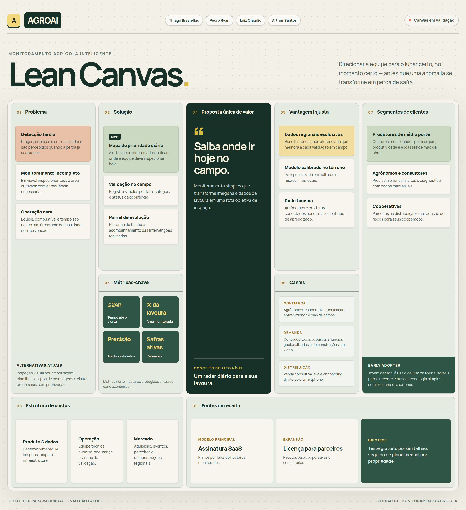
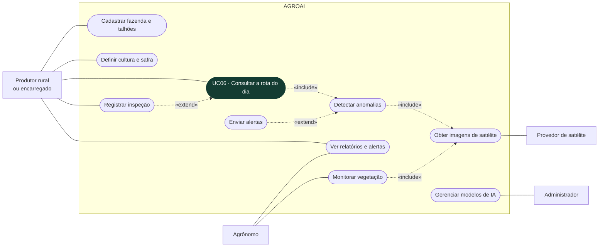
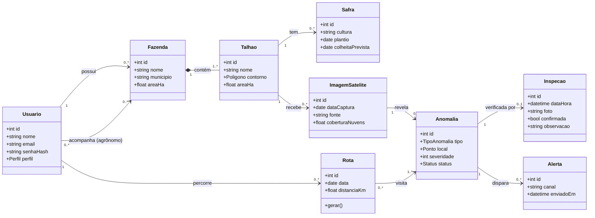

# Unidade 5 - Pitch do Produto: AGROAI

Entrega da Unidade 5 seguindo a estrutura de pitch deck da disciplina. O produto é o sistema de análise de fazendas com satélite e IA levantado na [Elicitação de Requisitos](ElicitacaoRequisitos/Atividade.md) e na [Modelagem de Sistemas](Modelagem_de_Sistemas/DorequisitoaoDiagramadeCasosdeUso.md).

**Sumário:** [1. Abertura](#1-slide-de-abertura) · [2. Problema](#2-problema-e-oportunidade) · [3. Solução](#3-solução-proposta) · [4. Lean Canvas](#4-lean-canvas) · [5. Requisitos](#5-requisitos-do-produto) · [6. Caso de uso](#6-especificação-de-caso-de-uso) · [7. Classes](#7-diagrama-de-classes) · [8. Equipe](#8-estrutura-da-equipe-ágil) · [9. MVP](#9-planejamento-do-mvp) · [10. Conclusão](#10-conclusão-do-pitch) · [11. Checklist](#11-checklist-final-para-apresentação)

---

## 1. Slide de abertura

- **Nome do produto:** AGROAI
- **Identidade visual:** logo, cores, tipografia e aplicações no [Brand Book do AGROAI](BrandBook/BrandBook_AGROAI.pdf) (também em [HTML](BrandBook/BrandBook_AGROAI.html))
- **Proposta de valor:**
  > "O AGROAI ajuda pequenos e médios produtores rurais a encontrar problemas na lavoura antes que virem prejuízo, por meio de imagens de satélite e IA que mostram onde ir hoje."
- **Integrantes:** Thiago Braziellas, Arthur Santos, Luiz Claudio e Pedro Ryan

## 2. Problema e oportunidade

**Problema:** o produtor não consegue olhar toda a lavoura com a frequência necessária. Quando uma praga, falha de plantio ou falta de água é percebida, o estrago já aconteceu.

**Quem é afetado:**
- Pequenos e médios produtores, que decidem e pagam a conta da perda
- Gerentes e encarregados de campo, que percorrem talhões sem problema
- Agrônomos e consultores, que perdem tempo em deslocamento sem saber onde está o foco
- Cooperativas, que sofrem com a inadimplência depois de uma safra ruim

**Dor atual e consequências:**

| Dor | Consequência |
|---|---|
| Monitoramento por amostragem, a pé ou de caminhonete | Áreas cegas e focos descobertos tarde |
| Identificação tardia de anomalias | Perda de produtividade e remediação mais cara |
| Mão de obra, combustível e tempo gastos em áreas sem problema | Custo operacional alto e margem menor |
| Ferramentas de agricultura de precisão caras e complexas | Pequeno produtor fica de fora |

**Por que é relevante:** imagens de satélite gratuitas (programa Copernicus, Sentinel-2) já cobrem qualquer fazenda a cada poucos dias. Falta transformar essas imagens em uma resposta simples para quem está no campo.

## 3. Solução proposta

Um aplicativo de celular que:
1. Recebe o contorno da fazenda e dos talhões desenhados no mapa.
2. Busca automaticamente as imagens de satélite mais recentes e calcula o vigor da vegetação.
3. Usa IA para apontar onde a lavoura está fora do padrão (estresse hídrico, pragas, erosão, falhas).
4. Entrega a **rota do dia**: a lista dos pontos que valem uma visita, em ordem de prioridade, com o caminho no mapa.
5. Recebe a confirmação de quem foi ao ponto (foto e observação), e esse retorno ensina o modelo a errar menos.

**Diferencial:** o produtor não precisa interpretar mapa de índice nem planilha. O app responde a uma pergunta só: *onde eu vou hoje?* Funciona sem sinal no campo e não exige treinamento técnico.

## 4. Lean Canvas

Versão visual feita pelo grupo no Figma: [imagem](LeanCanvas/LeanCanvas_AGROAI.png) e [HTML](LeanCanvas/LeanCanvas_AGROAI.html). O resumo em texto dos 9 blocos está na tabela abaixo.

| Bloco | AGROAI |
|---|---|
| **Problema** | Monitoramento incompleto; detecção tardia de pragas, doenças e estresse hídrico; alto custo de inspeção presencial |
| **Segmentos de clientes** | Pequenos e médios produtores de grãos. Early adopter: produtor de médio porte ou jovem gestor (segunda geração) que já usa o celular na rotina e teve perda recente |
| **Proposta de valor** | Saber onde ir hoje: menos área percorrida à toa e problemas encontrados antes |
| **Solução** | Imagens de satélite + IA que detectam anomalias + rota diária de inspeção + registro de campo offline |
| **Canais** | Indicação de agrônomos e consultores; cooperativas de insumos; dias de campo e feiras regionais; anúncios geolocalizados (Meta, Google, YouTube); lojas de aplicativo |
| **Fontes de receita** | Freemium (1 talhão grátis); assinatura anual por hectare monitorado; plano para consultores com várias fazendas *(valores a validar com os early adopters)* |
| **Estrutura de custos** | Equipe de desenvolvimento; processamento em nuvem das imagens e dos modelos; hospedagem; marketing e presença em eventos. Imagens Sentinel-2 não têm custo de licença |
| **Métricas principais** | Fazendas ativas por semana; % de rotas do dia abertas; % de alertas confirmados em campo (precisão); retenção de uma safra para a outra; conversão do plano grátis para o pago |
| **Vantagem injusta** | Base histórica própria de ocorrências georreferenciadas por região e modelos calibrados pelas inspeções dos usuários: quanto mais gente usa, mais preciso fica |

## 5. Requisitos do produto

### Requisitos funcionais

| Código | Requisito | Prioridade |
|---|---|---|
| RF01 | O sistema deve permitir cadastro e autenticação de usuários com perfil de produtor, agrônomo ou administrador. | Must |
| RF02 | O sistema deve permitir cadastrar a fazenda e desenhar os talhões no mapa. | Must |
| RF03 | O sistema deve permitir definir a cultura e a safra de cada talhão. | Must |
| RF04 | O sistema deve obter automaticamente as imagens de satélite de cada talhão a cada nova passagem disponível. | Must |
| RF05 | O sistema deve calcular o vigor da vegetação (NDVI) e detectar áreas fora do padrão do talhão. | Must |
| RF06 | O sistema deve gerar a rota do dia com os pontos críticos ordenados por prioridade. | Must |
| RF07 | O sistema deve permitir registrar a inspeção de um ponto com foto, confirmação e observação. | Must |
| RF08 | O sistema deve enviar alerta ao produtor e ao agrônomo quando surgir uma anomalia grave. | Should |
| RF09 | O sistema deve exibir relatórios por talhão com o histórico de vigor e de ocorrências. | Should |
| RF10 | O sistema deve permitir que o produtor dê acesso à fazenda a um agrônomo. | Should |
| RF11 | O sistema deve classificar o uso do solo e mapear relevo e terreno. | Could |
| RF12 | O administrador deve poder gerenciar e atualizar os modelos de IA. | Could |

### Requisitos não funcionais (ISO/IEC 25010:2023)

| Código | Requisito | Característica | Critério de aceitação |
|---|---|---|---|
| RNF01 | Registro de inspeção sem internet | Confiabilidade | A inspeção é salva offline e sincroniza sozinha em até 1 min depois que o sinal volta |
| RNF02 | Rota do dia rápida no celular | Eficiência de desempenho | Carrega em até 3 s em 95% das aberturas numa conexão 4G |
| RNF03 | Uso sem treinamento | Capacidade de interação | 4 de 5 produtores de teste chegam à primeira rota em até 10 min sem ajuda |
| RNF04 | Proteção dos dados da propriedade (LGPD) | Segurança | Só o produtor e os agrônomos autorizados por ele veem a fazenda; tentativas negadas ficam registradas |
| RNF05 | Comunicação criptografada | Segurança | 100% das chamadas por HTTPS com TLS 1.2 ou superior |
| RNF06 | Alerta no tempo certo | Eficiência de desempenho | Alerta entregue em até 1 h depois que a imagem é processada |
| RNF07 | Disponibilidade | Confiabilidade | Serviço no ar em pelo menos 99,5% do mês |

## 6. Especificação de caso de uso

### Diagrama de casos de uso

O diagrama amplia o da [atividade de modelagem](Modelagem_de_Sistemas/DiagramaCasosDeUso_FazendasIA.jpeg) com os casos de uso centrais do produto: **Consultar a rota do dia** e **Registrar inspeção**.

### Especificação

| Campo | Descrição |
|---|---|
| **Caso de uso** | UC06 - Consultar a rota do dia |
| **Ator principal** | Produtor rural ou encarregado de campo |
| **Atores secundários** | Provedor de satélite, agrônomo |
| **Objetivo** | Saber quais pontos da lavoura visitar hoje e registrar o que foi encontrado |
| **Pré-condições** | Usuário autenticado; fazenda com talhões, cultura e safra cadastrados; pelo menos uma imagem processada |
| **Gatilho** | O usuário abre o aplicativo e toca em "Rota de hoje" |

**Fluxo principal**
1. O sistema mostra a data da última imagem e a lista de pontos críticos em ordem de prioridade.
2. O usuário toca em "Iniciar rota".
3. O sistema mostra o caminho no mapa até o primeiro ponto.
4. No ponto, o usuário tira uma foto e informa se o problema foi confirmado e qual é.
5. O sistema salva a inspeção e passa para o próximo ponto.
6. Ao final, o sistema mostra o resumo do dia e envia o resultado ao agrônomo responsável.

**Fluxos alternativos**
- **A1 - Nenhum ponto crítico:** no passo 1, o sistema informa "Nenhum ponto precisa de visita hoje" e mostra quando chega a próxima imagem.
- **A2 - Imagem coberta por nuvens:** no passo 1, o sistema usa a última imagem válida e avisa a data dela.
- **A3 - Sem internet no campo:** nos passos 4 e 5, a inspeção fica salva no aparelho e é enviada quando o sinal voltar (RNF01).
- **A4 - Problema não encontrado:** no passo 4, o usuário marca "Não encontrei nada"; o ponto vira falso positivo e serve para recalibrar o modelo.

**Pós-condições:** as inspeções ficam registradas no histórico do talhão, os pontos visitados saem da rota e o modelo recebe o retorno de campo.

## 7. Diagrama de classes

**Leitura do diagrama:** o produtor possui fazendas, que contêm talhões. Cada talhão tem safras e recebe imagens de satélite. Cada imagem pode revelar anomalias, que entram na rota do dia, disparam alertas e são verificadas por uma inspeção em campo.

## 8. Estrutura da equipe ágil

| Papel | Responsável | O que faz |
|---|---|---|
| Product Owner | Pedro Ryan | Representa o produtor, mantém e prioriza o backlog (MoSCoW) |
| Scrum Master | Luiz Claudio | Conduz as cerimônias, remove impedimentos e cuida do ritmo das sprints |
| Analista de requisitos e UX | Arthur Santos | Entrevista os early adopters, escreve casos de uso e critérios de aceite, desenha as telas |
| Desenvolvimento e testes | Thiago Braziellas, com apoio de todo o time | Implementa as funcionalidades, testa no campo e valida os critérios de aceite |

**Como o time trabalha:** sprints de 2 semanas; planejamento, daily de 15 min, revisão com um produtor parceiro e retrospectiva. Cada história só é "pronta" quando passa nos critérios de aceite e é testada no celular, sem internet.

## 9. Planejamento do MVP

O MVP valida uma única hipótese: **a rota do dia faz o produtor achar problemas antes e andar menos.**

| Entra no MVP | Fica para depois |
|---|---|
| Cadastro e login (RF01) | Alertas por WhatsApp e push (RF08) |
| Fazenda e talhões no mapa (RF02) | Relatórios históricos (RF09) |
| Cultura e safra (RF03) | Acesso do agrônomo (RF10) |
| Imagens Sentinel-2 automáticas (RF04) | Uso do solo, relevo e terreno (RF11) |
| Vigor da vegetação e áreas fora do padrão (RF05) | Gestão dos modelos de IA (RF12) |
| Rota do dia (RF06) | Drones e previsão de pragas |
| Inspeção com foto, offline (RF07) | Integração com cooperativas |

**Como validar:** 5 produtores early adopters usando durante 30 dias numa safra. Medimos a % de pontos confirmados em campo, o tempo gasto em inspeção antes e depois e se continuam abrindo a rota toda semana.

## 10. Conclusão do pitch

| Pergunta | Resposta |
|---|---|
| Qual é o problema? | O produtor descobre pragas, falhas e falta de água tarde demais, porque não consegue olhar toda a lavoura. |
| Para quem é a solução? | Pequenos e médios produtores, começando pelo jovem gestor que já usa o celular no campo. |
| Como ela funciona? | Satélite + IA encontram as áreas fora do padrão e o app transforma isso numa rota do dia. |
| Por que é importante? | Menos perda de safra, menos custo de inspeção e acesso à agricultura de precisão sem equipamento caro. |
| Como a equipe vai desenvolver e validar? | Scrum com sprints de 2 semanas e um MVP testado por 5 produtores durante 30 dias. |

## 11. Checklist final para apresentação

- [x] Problema bem definido
- [x] Público-alvo identificado
- [x] Requisitos funcionais descritos
- [x] Requisitos não funcionais definidos
- [x] Caso de uso especificado
- [x] Diagrama de classes apresentado
- [x] Estrutura da equipe ágil explicada
- [x] Lean Canvas preenchido
- [x] MVP apresentado de forma clara
- [x] Mensagem final objetiva e convincente
